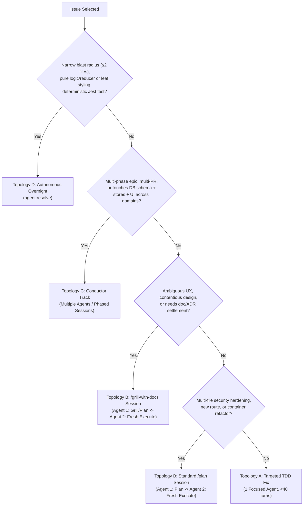

# GitHub Issue Prioritization & Execution Architecture

**Repository:** `jarredb9/finger-lakes-app-57`  
**Date:** November 5, 2026  
**Author:** Staff Software Engineer & Architect  
**Live Project Board:** [Winery Planner — Master Priority & Agent Execution Board (GitHub Projects #2)](https://github.com/users/jarredb9/projects/2)

---

## 1. Work Order Policy: Milestone-First with P0 Stop-the-Line

To eliminate ambiguity when pulling tasks or starting agent sessions, work order is governed by a **Milestone-Bounded, Severity-Sorted** rule:

```
┌────────────────────────────────────────────────────────────────────────┐
│                      THE GOLD STANDARD PULL ORDER                      │
├────────────────────────────────────────────────────────────────────────┤
│ 1. Current Active Milestone ONLY (v3.7.1)                              │
│    └── Work strictly in priority order: P0 -> P1 -> P2                 │
│    └── NEVER pull from v3.8.0 or v3.9.0 until v3.7.1 is tagged.        │
├────────────────────────────────────────────────────────────────────────┤
│ EXCEPTION: THE "STOP-THE-LINE" INTRUSION                               │
│ If a genuine P0 (live security breach, active data loss/corruption)    │
│ is discovered anywhere in the repository:                              │
│    └── Immediately pull it into the active milestone (or hotfix tag). │
│    └── Halt all forward feature work until the P0 is verified & closed.│
├────────────────────────────────────────────────────────────────────────┤
│ 2. When v3.7.1 is 100% closed & tagged:                                │
│    └── Advance active pointer to v3.8.0.                               │
│    └── Work strictly: P1 -> P2 -> P3 within v3.8.0.                    │
└────────────────────────────────────────────────────────────────────────┘
```

> [!IMPORTANT]
> **No Hypothetical P0s in Distant Milestones:**  
> A true P0 affects active production code today. If an issue is classified as P0, it belongs in the active milestone (`v3.7.1`). If an issue represents a critical prerequisite for a *future* milestone feature (e.g., PostGIS for navigation in `v3.9.0`), it is classified as **Tier 5 (Platform Strategic)**, not an emergency P0.

---

## 2. Priority & Resolution Framework

### 2.1 Priority Tiers

Issues are ranked by balancing user impact, data integrity risk, architectural dependencies, security perimeter defense, and milestone alignment:

```
┌────────────────────────────────────────────────────────────────────────┐
│ Tier 1: Production Integrity, Secrets & Database/Edge Security (P0)    │
│ Database PostgREST RLS & storage (#93), Edge Function caller auth and  │
│ private review isolation (#94), client cache poisoning (#73, #75).     │
│ (Resolved in v3.7.1: #97 CI secrets/sandbox escape, #87 RLS/RPCs).     │
├────────────────────────────────────────────────────────────────────────┤
│ Tier 2: Broken Core User Flows, Web & Client Perimeter Hardening (P1)  │
│ Dead-end 404s on winery share URLs (#41), open redirects & reset host  │
│ header poisoning (#95), client render crash DoS & offline DLQ plaintext│
│ persistence (#96), leaked password checks (#88), offline SyncService   │
│ retry/replay races (#123), and silent Trip Collaborator RLS drops      │
│ & unwired Trip Realtime sync (#119).                                   │
├────────────────────────────────────────────────────────────────────────┤
│ Tier 3: Core UX Enablers & Milestone v3.8.0 Alignment                 │
│ Planning friction (#50), map layout overlays (#89, #92), multi-trip    │
│ modal badges (#109), Visit History pagination/edit/lightbox & global   │
│ Varietal fixes (#124), Amenity decoupling (#74), viewport search &     │
│ enrichment-aware discovery filtering (#47, #122).                      │
├────────────────────────────────────────────────────────────────────────┤
│ Tier 4: Foundational Architecture, Scalability & Technical Debt        │
│ Viewport-bounded get_map_markers & client boot auth waterfall (#120),  │
│ coordinate/schema contractions (#61, #55), Postgres RLS InitPlan &     │
│ hot-path indexing (#121), TypeScript (#52), decomposition (#31), #115. │
├────────────────────────────────────────────────────────────────────────┤
│ Tier 5: Strategic Platform Capabilities (Milestone v3.9.0)            │
│ Day-Trip Companion lifecycle ('Plan -> Navigate -> Log', #118),        │
│ Google OAuth (#32), winery lifecycle (#34), PostGIS guides (#13).      │
├────────────────────────────────────────────────────────────────────────┤
│ Tier 6: Long-term Social, Tasting & Discovery Backlog (Milestone v3.10)│
│ Per-wine Tasting records (#125), social visit tagging (#46),           │
│ taste profiles (#45), and global community activity feed (#48).        │
├────────────────────────────────────────────────────────────────────────┤
│ Tier 7: Autonomous Developer Tooling & Pipeline Infrastructure         │
│ agent-resolve engine, conductor-prompt package, token caps, & skills.  │
└────────────────────────────────────────────────────────────────────────┘
```

---

### 2.2 Context Hygiene, Session Budgets & Agent Topologies

To prevent context bloat (>120k tokens / >50 turns) that leads to degraded code quality, hallucinations, and shallow patches, work is classified into 4 explicit **Agent Execution Topologies**:

| Topology | Label & Profile | When to Use | Context Hygiene Protocol |
| :--- | :--- | :--- | :--- |
| **Topology A** | **Single Focused Agent**<br>`1 Session, <40 turns` | Surgical, low-exploration tasks (<3 files) with well-understood reproduction seams. | Research and implementation happen in one clean session. Avoid reading non-essential files. |
| **Topology B** | **Decoupled Plan -> Fresh Execution**<br>`2 Sessions / Agents` | Bounded tasks requiring substantial architecture or UX alignment (security, routing, slots). | **Session 1 (Architect/Planner):** Conducts interview or `/plan`, delegating broad research to background subagents (`invoke_subagent`) to keep context <30k tokens. Emits approved `implementation_plan.md`.<br>**Session 2 (Implementer):** Starts in a **fresh context window** seeded strictly with the approved plan artifact to execute Red/Green TDD. |
| **Topology C** | **Conductor Track**<br>`Multiple Agents / Phased Sessions` | Multi-domain, high-risk, or multi-PR epics spanning database DDL, state engines, and UI. | Managed in `conductor/tracks/` with 3–4 tasks per phase. Each phase runs in a fresh agent session (<60 turns) with phase verification checkpoints and git notes. |
| **Topology D** | **Autonomous Overnight**<br>`1 Headless Agent` | Narrow blast radius ($\le 2$ files), pure-logic, data migrations, or leaf-component styling with deterministic Jest assertions. | Headless AFK batch runner (`scripts/agent-resolve/agent-resolve.py`) with strict turn and token caps. Zero human interaction. |



---

### 2.3 Workflow Archetypes & Resolution Playbook

| Workflow Archetype | Primary Entry Command | Scope & Boundary | Artifacts & Output |
| :--- | :--- | :--- | :--- |
| **`Conductor Track`** | `/conductor-new-track` -> `conductor-implement` | Multi-phase initiatives; strict expand-and-contract; 3–4 tasks per phase. | `spec.md`, `plan.md`, git notes checkpoints, `tracks.md` registry. |
| **`Standard /plan Session`** | `/plan` -> interactive implementation | Bounded single PR; well-specified requirements; high architectural/security rigor. | `implementation_plan.md` artifact (user approved) -> TDD -> `walkthrough.md`. |
| **`/grill-with-docs Session`** | `/grill-with-docs` -> `/plan` | Underspecified requirements; UX trade-offs; domain language settlement. | Updates `CONTEXT.md` / ADRs -> implementation plan -> fresh execution. |
| **`Autonomous Overnight (agent:resolve)`** | `agent:resolve` label or `agent-resolve.py` | Headless overnight batch execution at 20:00 EST; pure data/logic or leaf styling. | Automated Red/Green TDD Draft PR with Architectural Scorecard. |
| **`Targeted TDD Fix Session`** | `/tdd` / standard interactive session | Surgical bug fixes (<3 files); clear root cause; deterministic reproduction seam. | Failing regression test -> minimal fix -> clean commit. |

---

## 3. Live Prioritization Matrix (GitHub Projects v2)

> [!TIP]
> **Single Source of Truth:**  
> Live issue rack-and-stack ordering, statuses, milestones, custom priority tiers, and agent topologies are tracked interactively on the GitHub Projects board to eliminate doc staleness and merge conflicts:
>
> 🚀 **[GitHub Project #2: Winery Planner — Master Priority & Agent Execution Board](https://github.com/users/jarredb9/projects/2)**

### Recommended Board Views in GitHub Projects

1. **Active Milestone View (Default):**
   * **Filter:** `no:milestone,milestone:"v3.7.1 - Security Hardening & Production Defense"`
   * **Group:** `Milestone`
   * **Sort:** `Priority Tier` ascending
   * *Purpose:* Enforces the Milestone-First rule. Focuses strictly on closing `v3.7.1` before looking ahead.
2. **Roadmap & Milestone Progression:**
   * **Group:** `Milestone`
   * **Sort:** `Priority Tier` ascending
   * *Purpose:* Displays the complete release sequence: `v3.7.1` $\rightarrow$ `v3.8.0` $\rightarrow$ `v3.9.0` $\rightarrow$ `v3.10.0` $\rightarrow$ `Tooling`.
3. **Agent Autonomous Queue (Topology D):**
   * **Filter:** `is:open Topology:"Topology D: Autonomous Overnight"`
   * *Purpose:* Direct input feed for overnight headless batch runners (`agent-resolve.py`).

### CLI Quick Access (`gh` CLI)

```bash
# List open items in the project board
gh project item-list 2 --owner jarredb9 --format json

# Add a newly discovered issue to the project board
gh project item-add 2 --owner jarredb9 --url "https://github.com/jarredb9/finger-lakes-app-57/issues/<id>"
```

---

## 4. Immediate Phasing & Execution Next Steps

```
Milestone v3.7.0 Release Gate
 └── Tag v3.7.0 & bump package.json version -> Closes Milestone v3.7.0 (0 open issues)
 │
Milestone v3.7.1 - Security Hardening & Production Defense (CURRENT ACTIVE FOCUS)
 ├── [x] Step 1: Fix #97 (CI & Runner Security) -> Merged via PR #102
 ├── [x] Step 2: Fix #87 (Database Security Part 1) -> Merged via PR #111
 ├── [~] Step 3: Finish #93 (Database Security Part 2 + profiles.email caller alignment) -> Topology C [Conductor Track]
 ├── Step 4: Fix #94 (Edge Functions Security) -> Topology B [Standard /plan Session: 2 Agents]
 ├── Step 5: Fix #73 (Amenities v3 Cache Migration) -> Topology A [Targeted TDD Fix Session: 1 Agent]
 ├── Step 6: Fix #75 (PWA Hours Bug) -> Topology A [Targeted TDD Fix Session: 1 Agent]
 ├── Step 7: Fix #95 (Web Route & Auth Hardening) -> Topology B [Standard /plan Session: 2 Agents]
 ├── Step 8: Fix #96 (Client Stability & Storage Privacy) -> Topology B [Standard /plan Session: 2 Agents]
 └── Step 9: Implement #88 (HaveIBeenPwned Leaked Password Check) -> Topology B [Standard /plan Session: 2 Agents]
 │
Milestone v3.8.0 - Component Decomposition, Performance & UI Modernization (LOCKED UNTIL v3.7.1 TAGGED)
 ├── Step 10: Grill & Fix #123 (SyncService 5xx Timers & Cross-Tab Replay Lock) -> Topology B [/grill-with-docs -> Execute]
 ├── Step 11: Grill & Fix #119 (Collaborative Trip Realtime & RLS Alignment) -> Topology B [/grill-with-docs -> Execute]
 ├── Step 12: Fix #41 (Deep Linking 404) -> Topology B [Standard /plan Session: 2 Agents]
 ├── Step 13: Implement #50 (WineryModal Upcoming Trips Checklist) -> Topology A [Standard /plan Session: 1 Agent]
 ├── Step 14: Merge #89 (PR #99) / Execute #92 (MapOverlayLayout Slot Architecture) -> Topology B [Standard /plan Session: 2 Agents]
 ├── Step 15: Implement #109 (WineryModal Multi-Trip Badges) -> Topology B [Standard /plan Session: 2 Agents]
 ├── Step 16: Grill & Fix #124 (Visit History Pagination, Direct Edit, Signed Photo Batching & Global Varietals) -> Topology B [/grill-with-docs -> Execute]
 ├── Step 17: Grill & Implement #74 (Visitor Amenities & Vibe Tags), #47 (Search This Area), & #122 (Enrichment-Aware Filters) -> Topology B [/grill-with-docs -> Execute]
 ├── Step 18: Grill & Execute #120 (Viewport-Bounded get_map_markers [ADR-0011], Lazy Places SDK & Boot Waterfall) -> Topology C [Conductor Track]
 ├── Step 19: Execute #61 (Coordinate standardizations: Topology D), #55 (Drop follows schema: Topology A), & Grill #121 (RLS InitPlan 0003 & FK Indexes 0001: Topology B)
 ├── Step 20: Execute #52 (TypeScript Epic PRs 2–4) -> Topology C [Conductor Track: Multiple Phased Agents]
 ├── Step 21: Execute #115 (Jest ESM Transpilation & Major UI/Auth Dependency Migrations) -> Topology B [Standard /plan Session: 2 Agents]
 └── Step 22: Execute #31 (Component Decomposition) -> Topology C [Conductor Track: Multiple Phased Agents]
 │
Milestone v3.9.0 - Platform Feature Expansions (FUTURE QUEUE)
 ├── Step 23: Grill & Implement #118 (Day-Trip Companion Lifecycle [ADR-0012]: Schedule Warnings, Road Trip Legs & Visit Completion) -> Topology C [Conductor Track]
 ├── Step 24: Implement #32 (Google OAuth & Account Linking) -> Topology C [Conductor Track: Multiple Phased Agents]
 ├── Step 25: Implement #34 (Winery Lifecycle / Rebranding) -> Topology C [Conductor Track: Multiple Phased Agents]
 └── Step 26: Implement #13 (Mapbox Markers & PostGIS Regions) -> Topology C [Conductor Track: Multiple Phased Agents]
 │
Milestone v3.10.0 - Social Discovery, Tasting & Recommendations (BACKLOG QUEUE)
 ├── Step 27: Grill & Implement #125 (Wine-Level Tasting Records Within a Visit) -> Topology C [Conductor Track]
 └── Step 28: Implement #46 (Social Tagging), #45 (Taste Profiles), & #48 (Community Feed) -> Topology C [Conductor Track: Multiple Phased Agents]
```
